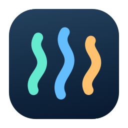
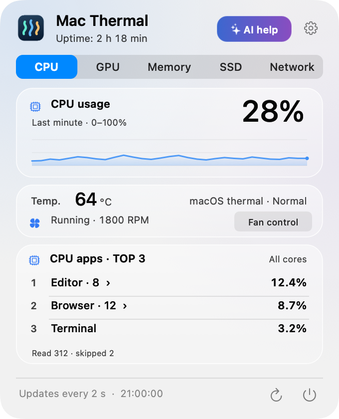
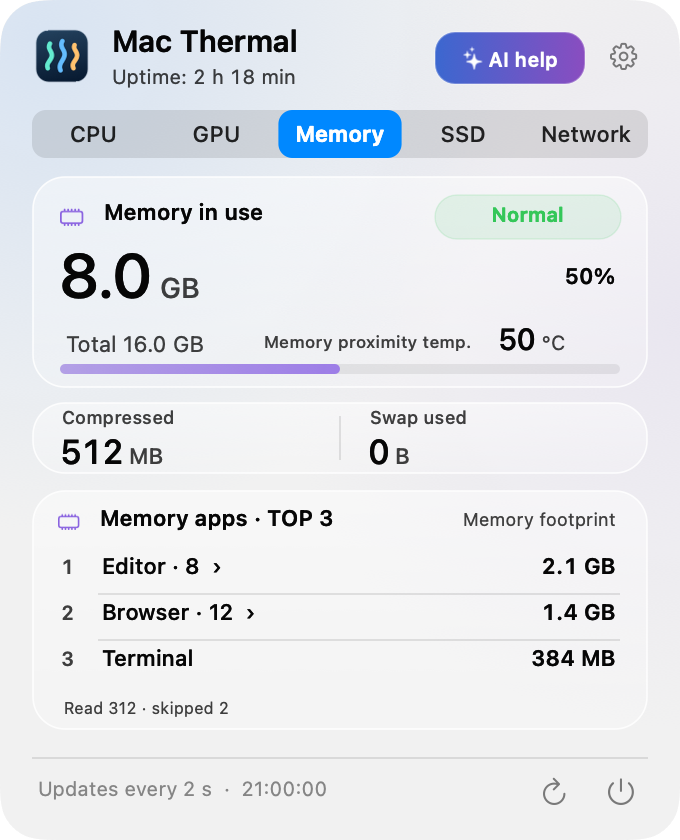
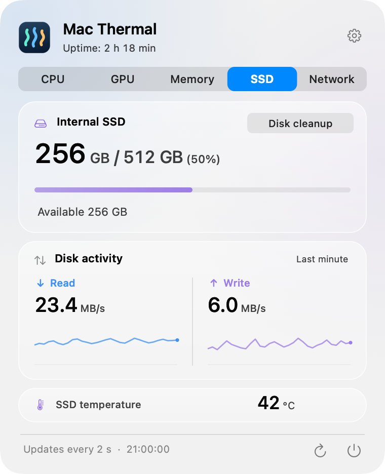
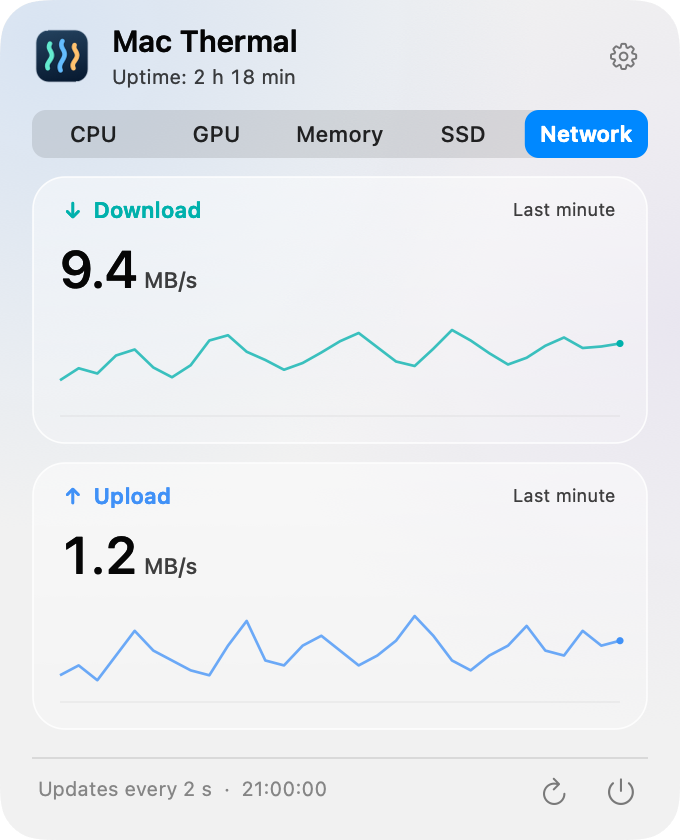
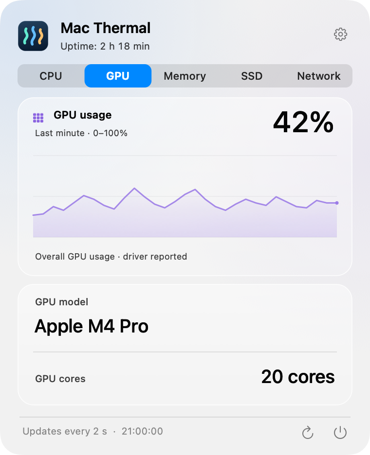

<p align="center">
  
</p>

<h1 align="center">Mac Thermal</h1>

<p align="center">
  <strong>Your Mac's status, at a glance in the menu bar.</strong><br>
  A free, open-source app that adds a little motion to temperatures, resource usage, and transfer rates.
</p>

<p align="center">
  
</p>

<p align="center">
  <a href="README.md">한국어</a> · <strong>English</strong> · <a href="README.ja.md">日本語</a> · <a href="README.zh-CN.md">简体中文</a>
</p>

<p align="center">
  <a href="https://github.com/PIYoung/mac-thermal/releases/latest"><strong>↓ Download</strong></a> ·
  <a href="#install">Installation</a> ·
  <a href="RELEASES.md">Changelog</a> ·
  <a href="docs/DETAILS.md">Technical details</a>
</p>

---

## A glance at the menu bar

Check CPU, GPU, SSD, and network activity together without opening the panel. The numbers are measured values; the motion gives you a sense of how busy your Mac is.

<p align="center">
  <picture>
    <source media="(prefers-reduced-motion: reduce)" srcset="docs/images/menubar.png">
    
  </picture>
  <br>
  <sub>Synthetic example rendered by the actual app. <a href="docs/images/menubar.png">View the still image</a></sub>
</p>

| CPU rhythm | SSD waves | Network flow |
| :--- | :--- | :--- |
| Temperature and utilization, with bars that move as activity rises. Orbiting dots are also available. | Read and write rates. The fill level shows used capacity; waves reflect I/O activity. | Upload and download rates, with flow in each transfer direction. The flow stops when transfers stop. |

Menu bar text turns **orange or red** with the system's thermal state. Turn motion off or adjust its intensity in Settings. The app also follows macOS **Reduce Motion**.

The menu bar shows **CPU, GPU, SSD, and network by default**. Use the individual checkboxes under **Settings → Menu bar metric** to choose what you see. Groups fit their content with compact gaps, including between SSD and network; hidden items leave no empty slot. More tiles light up and the gentle brightness wave speeds up as utilization rises; it stops at 0%. The 12 tiles are usage steps, not physical cores.

<p align="center">
  <picture>
    <source media="(prefers-reduced-motion: reduce)" srcset="docs/images/menubar-gpu.png">
    
  </picture>
</p>

## Click for a closer look

Click the menu bar to open a fixed-size panel. The CPU tab opens first; later, the app remembers the last tab you viewed. Click an image to enlarge it.

<table>
  <tr>
    <th>CPU</th>
    <th>Memory</th>
  </tr>
  <tr>
    <td align="center">
      <a href="docs/images/panel-en-cpu.png"></a><br>
      <sub>Utilization graph · Temperature · Top 3 processes</sub>
    </td>
    <td align="center">
      <a href="docs/images/panel-en-memory.png"></a><br>
      <sub>Memory pressure · Compression and swap · Top 3 processes</sub>
    </td>
  </tr>
  <tr>
    <th>SSD</th>
    <th>Network</th>
  </tr>
  <tr>
    <td align="center">
      <a href="docs/images/panel-en-ssd.png"></a><br>
      <sub>Free space · Read and write graphs · Temperature</sub>
    </td>
    <td align="center">
      <a href="docs/images/panel-en-network.png"></a><br>
      <sub>Download and upload · Past-minute graphs</sub>
    </td>
  </tr>
  <tr><th colspan="2">GPU</th></tr>
  <tr><td colspan="2" align="center">
    <a href="docs/images/panel-en-gpu.png"></a><br>
    <sub>Usage graph · GPU model · Core count</sub>
  </td></tr>
</table>

<sub>All previews use synthetic example data. Glass effects may vary with the macOS version.</sub>

**Korean by default · 4 languages · Light and dark appearance · Uptime · Launch at login**<br>
Use the top-right Settings button to change the language, menu bar motion, and automatic startup. No accounts, ads, analytics, or server uploads. Graph history stays in memory.

## Install

Runs on an **Apple Silicon Mac with macOS 14 or later**. Release binaries are ARM64 only; Intel Macs are not supported.

1. Download a **DMG** from the [latest release](https://github.com/PIYoung/mac-thermal/releases/latest). A ZIP is also available.
2. Open the DMG and drag **Mac Thermal.app** into **Applications**.
3. Launch the app and click its menu bar indicators. It does not show a Dock icon.

> **Before downloading** — The app is currently ad-hoc signed, without Apple Developer ID signing or notarization. If macOS blocks it, build from source below instead of disabling security settings. Verify file integrity against the release's `SHA256SUMS`.

There is no automatic updater. Install new versions from the [Releases page](https://github.com/PIYoung/mac-thermal/releases).

<details>
<summary><strong>Build and install from source</strong></summary>

Requires Apple Silicon and **Xcode 26, or compatible Command Line Tools with the macOS 26 SDK**. The deployment target is macOS 14 or later. Before macOS 26, the app uses a standard translucent panel.

```sh
git clone https://github.com/PIYoung/mac-thermal.git
cd mac-thermal
zsh scripts/install.sh --open
```

Installs to `~/Applications/Mac Thermal.app` and launches it. Omit `--open` to install without launching. No `sudo` is used. To build only, run `zsh build.sh`. The result is `build/Mac Thermal.app`.

</details>

<details>
<summary><strong>Automatic startup and measurement limits</strong></summary>

- **Launch at login:** Toggle it in Settings. First-launch registration is automatic only when the app runs from `~/Applications`. A DMG installation in `/Applications` does not register automatically. If macOS requests approval, allow it in the system's Login Items settings.
- **GPU:** Shows driver-reported overall utilization, model, and core count. Live readings were verified on Apple M4 Pro; availability varies by chip and macOS. Unavailable values show `—` in the menu bar and “Unavailable” in the panel. GPU temperature and NPU utilization are not provided.
- **CPU temperature:** The highest readable core sensor value. Sensor readings have been validated on Apple M4 Pro; compatibility with other chips is unverified. Unavailable values display `—`.
- **Thermal state:** Reported by macOS, rather than inferred from arbitrary temperature thresholds. The app does not control fans or cooling.
- **Memory:** Usage, pressure, compression, and swap. Memory temperature is not provided.
- **Top 3:** Rankings are per process, without aggregating an app's processes. CPU percentages are normalized across all logical cores.
- **SSD and network:** SSD I/O covers the entire internal physical SSD. Network rates cover active `en*` interfaces, excluding VPN and loopback traffic.
- **Updates:** Measurements update every two seconds; motion runs at up to 8fps. Motion pauses according to user settings, Reduce Motion, sleep, display-off, and idle states.

See the [technical details](docs/DETAILS.md) for calculations and compatibility limits. This document is currently in Korean.

</details>

## Contribute

**Made with AI.** Code, UI, translations, and documentation were created with OpenAI Codex and refined through iterative user feedback.

[Bugs and feature ideas](https://github.com/PIYoung/mac-thermal/issues) · [Contributing guide](CONTRIBUTING.md) · [Security reports](SECURITY.md)

For sensor reports, include your Mac chip and macOS version. Redact personal information and other apps' process names when sharing screenshots or logs.

Released under the [MIT License](LICENSE). Copyright and MIT notices for the Stats sensor references are preserved in the [third-party notices](THIRD_PARTY_NOTICES.txt). The app icon, UI, graphs, and motion are independently implemented. System symbols and fonts remain subject to their providers' terms. [Code and asset provenance](ASSET_PROVENANCE.md)

<sub>README layout inspired by <a href="https://github.com/othneildrew/Best-README-Template">Best-README-Template</a> (Unlicense). Introductory text and images were created for this project.</sub>
