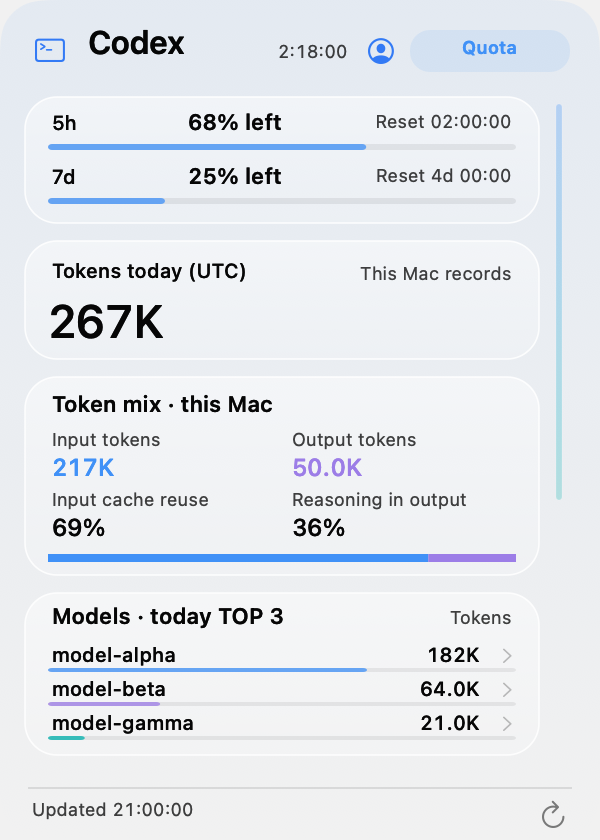

<p align="center"></p>
<h1 align="center">Mac Thermal</h1>
<p align="center"><strong>Your Mac, at a glance in the menu bar.</strong><br>Apple Silicon · macOS 14+ · MIT</p>
<p align="center"><a href="README.md">한국어</a> · <strong>English</strong> · <a href="README.ja.md">日本語</a> · <a href="README.zh-CN.md">简体中文</a></p>
<p align="center"><a href="https://github.com/PIYoung/mac-thermal/releases/latest"><strong>↓ Download</strong></a> · <a href="RELEASES.md">Changelog</a></p>

## Menu bar and panels

<p align="center"></p>
<table align="center">
  <tr><th>Codex companion</th><th>Resource panel</th></tr>
  <tr>
    <td><a href="docs/images/codex-en-light.png"></a></td>
    <td><a href="docs/images/panel-en-cpu.png"></a></td>
  </tr>
</table>
<sub>Synthetic examples drawn by the actual app renderer. Translucency varies by macOS version.</sub>

## Features

- **Menu bar:** CPU temperature and usage, GPU usage, SSD read/write rates, network speeds and animated indicators.
- **Click-open panel:** CPU, GPU, memory, SSD and network tabs, recent graphs, top three CPU/memory processes and system uptime.
- **Temperatures and fans:** CPU/GPU/SSD temperatures, memory **proximity temperature**, independent warning colors, and fan status with actual RPM in the CPU panel. Sensor availability varies by device.
- **Codex:** A left companion shows local tokens today, input/output, cache reuse and model TOP 3. Optional account quota and activity summaries share a scrolling card layout with an original slim scrollbar.
- **Disk cleanup:** Start a home scan without choosing a folder. Select candidates yourself, then confirm before moving them to Trash. Optional one-folder scanning remains available.
- **Settings:** Choose metrics, motion and startup at login. Korean by default; English, Japanese and Simplified Chinese supported.

## Install

1. Download the **DMG** from the [latest release](https://github.com/PIYoung/mac-thermal/releases/latest). ZIP is also available.
2. Open the DMG and drag **Mac Thermal.app** to **Applications**.
3. Launch the app and click its menu bar indicators. Install a newer release to update.

> This build is ad-hoc signed and not notarized by Apple. If macOS blocks it, build from source below instead of disabling security settings. Verify downloads against `SHA256SUMS`.

<details>
<summary>Build and install from source</summary>

Requires Apple Silicon and Xcode 26 or compatible Command Line Tools with the macOS 26 SDK.

```sh
git clone https://github.com/PIYoung/mac-thermal.git
cd mac-thermal
zsh scripts/install.sh --open
```

Quit the existing app first. Installs into `~/Applications`; no `sudo` required.

</details>

## Codex records and privacy

Codex record reading is **OFF by default**. When enabled, only model names, token numbers and timestamps from `~/.codex/sessions` are aggregated in memory. These files also contain conversations, but bodies, commands and credentials are never kept, displayed or transferred. Source files are unchanged; switching off stops reading and clears aggregation.

Usage covers **this Mac’s records for today (UTC)**, not account totals or billing. Optional [official sign-in](docs/CODEX_ACCOUNT.md) adds remaining account quota and reset countdowns after separate consent. Daily numeric summaries and lifetime/streak account summaries each require additional opt-in. There is no developer collection server, analytics SDK or remote log upload. The robot stops after 10 seconds without another new record; it does not indicate live token consumption or task completion.

Quota-reset notifications are optional in Settings (OFF by default). While the app is running and account quota is connected, a confirmed server reset triggers one local alert. macOS notification permission is required; no additional polling or data collection is added.

---

[Technical details](docs/DETAILS.md) · [Security](SECURITY.md) · [Contributing](CONTRIBUTING.md) · [MIT License](LICENSE) · [Third-party notices](THIRD_PARTY_NOTICES.txt)

<sub>Made with AI assistance using OpenAI Codex and user feedback.</sub>
