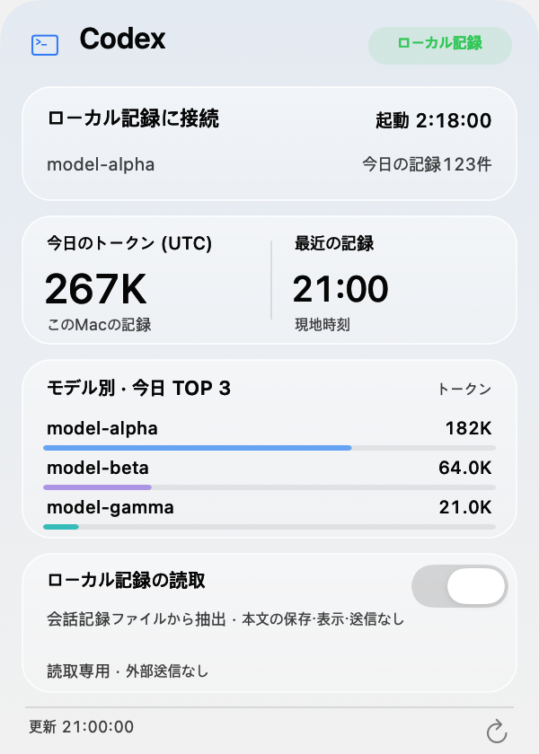
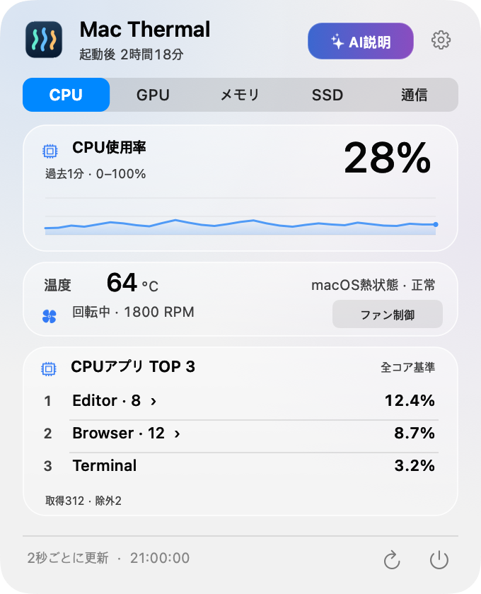

<p align="center"></p>
<h1 align="center">Mac Thermal</h1>
<p align="center"><strong>Macの状態を、メニューバーでひと目に。</strong><br>Apple Silicon · macOS 14+ · MIT</p>
<p align="center"><a href="README.md">한국어</a> · <a href="README.en.md">English</a> · <strong>日本語</strong> · <a href="README.zh-CN.md">简体中文</a></p>
<p align="center"><a href="https://github.com/PIYoung/mac-thermal/releases/latest"><strong>↓ ダウンロード</strong></a> · <a href="RELEASES.md">更新履歴</a></p>

<p align="center"><a href="https://github.com/PIYoung/mac-thermal/releases/tag/v2.15.0"><strong>v2.15.0</strong></a> · 10種類のCPUアニメーション · 端末内AIの安定性を改善</p>

## メニューバーとパネル

<p align="center"></p>
<table align="center">
  <tr><th>Codex補助パネル</th><th>リソースパネル</th></tr>
  <tr>
    <td><a href="docs/images/codex-ja-light.png"></a></td>
    <td><a href="docs/images/panel-ja-cpu.png"></a></td>
  </tr>
</table>
<sub>実際のアプリ描画による合成例です。半透明効果はmacOSのバージョンで異なります。</sub>

## 主な機能

- **メニューバー:** CPU温度・使用率、GPU使用率、SSD読み書き、ネットワーク速度と動く指標。
- **クリックでパネル:** CPU・GPU・メモリ・SSD・通信タブ、最近のグラフ、CPU・メモリ上位3プロセス、起動後の経過時間。
- **温度とファン:** CPU・GPU・SSD温度とメモリ**周辺温度**、項目別の警告色、CPUパネルのファン状態と実測RPM。センサー対応は機種によって異なります。
- **状態案内・AI説明:** 各リソースタブで測定根拠と推奨操作を確認できます。対応するmacOS 26以降では要求時のみAppleの端末内モデルで短く説明し、モデル未対応・継続的な高温・生成エラー時は理由と基本案内を表示します。
- **Codex:** 左の補助パネルに今日のローカルトークン・入出力・キャッシュ再利用率・モデルTOP 3を表示。任意のアカウント上限と活動要約を追加でき、細い独自スクロールバーでカードをまとめて移動します。
- **ディスク整理:** フォルダ指定なしでホームを自動検査。候補を手動で選び、最終確認後にゴミ箱へ移動。特定フォルダのみの検査も可能。
- **設定:** 表示項目・10種類のCPUアニメーション・動き・ログイン時の起動を変更。韓国語が既定で、英語・日本語・簡体字中国語にも対応。

<details>
<summary>v2.15.0 — CPUの動きとAI説明の改善</summary>

- **CPUの動き:** 設定でリズムバー・回転ドット・ウェーブ・風車・バウンドボール・レーダー・ピストン・コンベア・砂時計・振り子を選べます。CPU使用率に応じて速度が変わり、動きの無効化とmacOSの「視差効果を減らす」に対応します。
- **AI説明:** 一時的な温度上昇による中断を減らしました。継続的な高温や深刻な熱・メモリ負荷では理由と基本案内を表示します。モデル使用中のエラーは1回だけ再試行し、応答待ちは全体で最大45秒です。根拠IDの形式を固定し、検証できない数値の文を除外します。

対応するmacOS 26以降と準備済みのApple Intelligenceが必要です。既存の測定数値とアプリの案内文のみを端末内モデルへ渡し、クラウドへの切り替えは行いません。

</details>

## インストール

1. [最新リリース](https://github.com/PIYoung/mac-thermal/releases/latest)から**DMG**をダウンロードします。ZIPもあります。
2. DMGを開き、**Mac Thermal.app**を**Applications**へドラッグします。
3. 起動してメニューバーをクリックします。更新時は新しいリリースをインストールします。

> このビルドはad-hoc署名で、Appleの公証はありません。macOSがブロックした場合、セキュリティ設定を解除せず下記のソースビルドをご利用ください。配布ファイルは`SHA256SUMS`で検証できます。

<details>
<summary>ソースからビルド・インストール</summary>

Apple Siliconと、macOS 26 SDKを含むXcode 26または互換Command Line Toolsが必要です。

```sh
git clone https://github.com/PIYoung/mac-thermal.git
cd mac-thermal
zsh scripts/install.sh --open
```

既存のアプリを終了してから実行してください。`~/Applications`にインストールします。`sudo`は不要です。

</details>

## Codex記録とプライバシー

Codex記録の読み取りは**既定でOFF**です。オンにすると`~/.codex/sessions`からモデル名・トークン数・時刻のみメモリに集計します。ファイルには会話本文もありますが、本文・コマンド・認証情報は保管・表示・送信せず、元ファイルも変更しません。オフで読み取りを止め、集計を消去します。

対象は<strong>このMacの今日の記録（UTC）</strong>で、アカウント全体の使用量・請求額ではありません。任意の[公式ログイン連携](docs/CODEX_ACCOUNT.md)は、別途同意後に残り上限とリセットまでの時間を表示します。日別の数値要約と累計トークン・連続使用日数などの要約も、それぞれ追加の同意が必要です。開発者の収集サーバー・分析SDK・リモートログ送信はありません。ロボットはCodex実行中はゆっくり動き、新しいトークン記録を検出すると10秒間活発に動いた後、ゆっくりした動きに戻ります。リアルタイムのトークン消費や作業完了を示すものではありません。

上限リセット通知は設定で任意に有効にできます（既定はOFF）。アプリ起動中かつアカウント接続中にサーバーの更新を確認すると、一度だけローカル通知します。macOSの通知許可が必要で、追加の問い合わせやデータ収集はありません。

---

[技術説明](docs/DETAILS.md) · [セキュリティ](SECURITY.md) · [貢献](CONTRIBUTING.md) · [MITライセンス](LICENSE) · [サードパーティ通知](THIRD_PARTY_NOTICES.txt)

<sub>OpenAI Codexとユーザーのフィードバックを活用し、AIの支援で制作しました。</sub>
