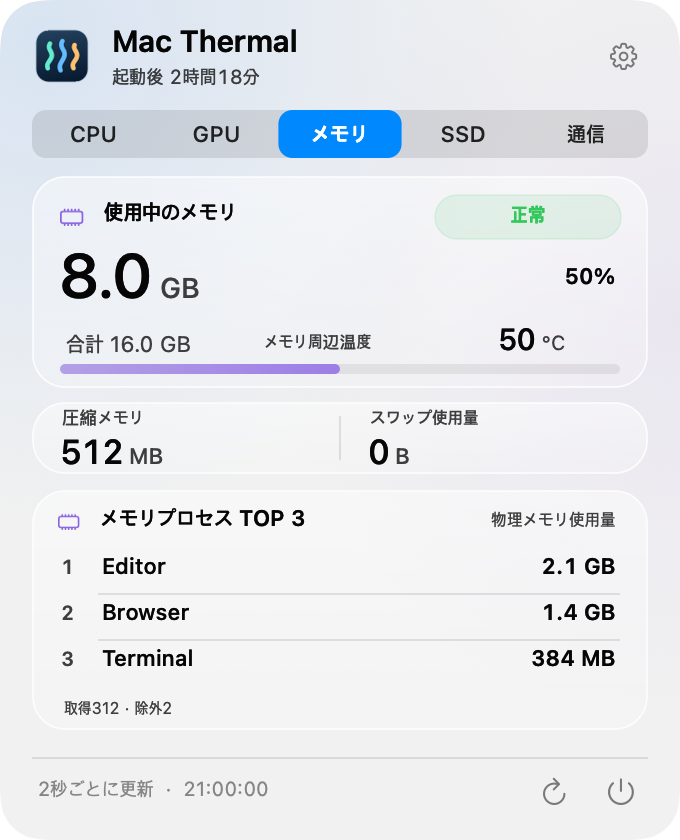
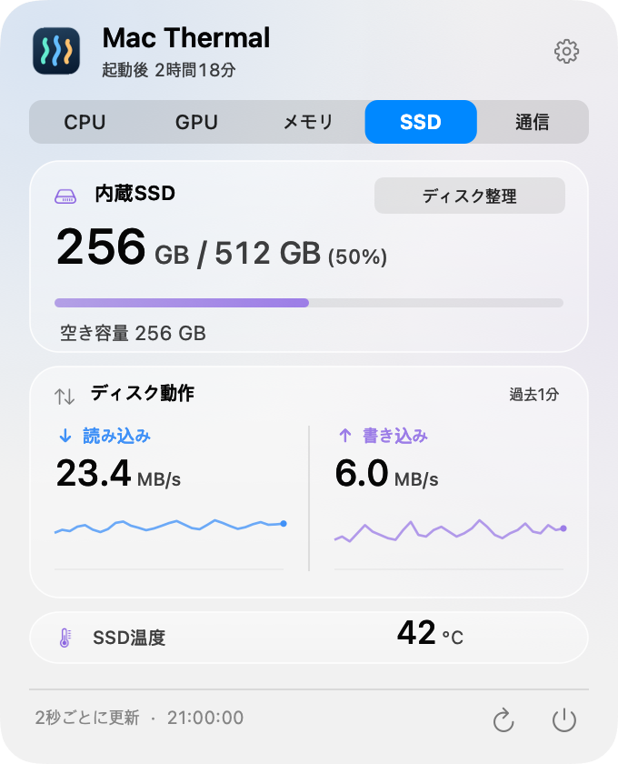
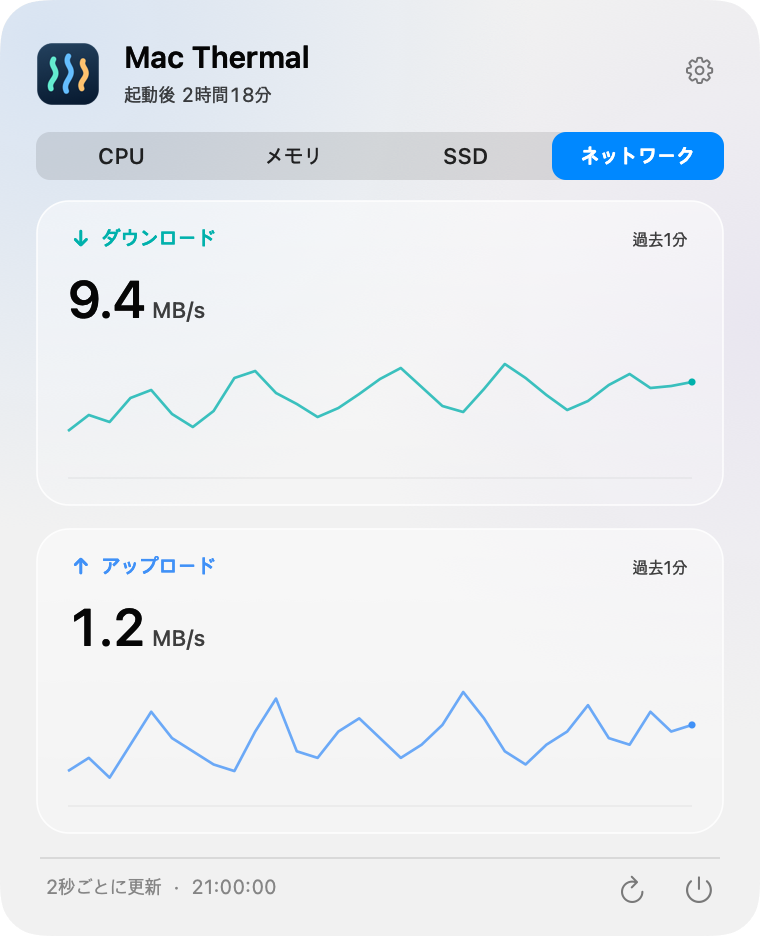
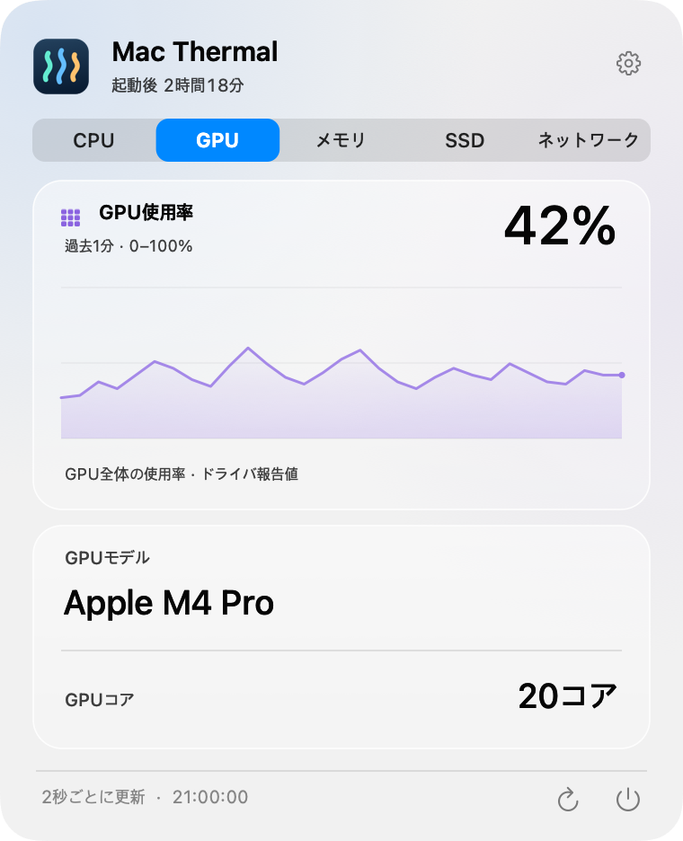

<p align="center">
  
</p>

<h1 align="center">Mac Thermal</h1>

<p align="center">
  <strong>Macの状態を、メニューバーでひと目に。</strong><br>
  温度・リソース使用量・転送速度に小さな動きを添える、無料のオープンソースアプリ。
</p>

<p align="center">
  
</p>

<p align="center">
  <a href="README.md">한국어</a> · <a href="README.en.md">English</a> · <strong>日本語</strong> · <a href="README.zh-CN.md">简体中文</a>
</p>

<p align="center">
  <a href="https://github.com/PIYoung/mac-thermal/releases/latest"><strong>↓ ダウンロード</strong></a> ·
  <a href="#インストール">インストール方法</a> ·
  <a href="RELEASES.md">更新履歴</a> ·
  <a href="docs/DETAILS.md">技術説明</a>
</p>

---

## メニューバーでひと目に

パネルを開かずに、CPU・GPU・SSD・ネットワークの状態を同時に確認できます。数値は実測値、動きは今どれだけ負荷がかかっているかの目安です。

<p align="center">
  <picture>
    <source media="(prefers-reduced-motion: reduce)" srcset="docs/images/menubar.png">
    
  </picture>
  <br>
  <sub>実際のアプリの描画処理による合成サンプルです。<a href="docs/images/menubar.png">静止画を見る</a></sub>
</p>

| CPUのリズム | SSDの波 | ネットワークの流れ |
| :--- | :--- | :--- |
| 温度と使用率を表示し、負荷に応じてバーが動きます。回転する点のスタイルも選べます。 | 読み書き速度を表示します。液面の高さは使用容量、波はI/O活動を表します。 | アップロード・ダウンロード速度と転送方向を流れで表します。転送が止まると流れも止まります。 |

システムの熱状態に応じて、メニューバーの文字が**オレンジ・赤**に変わります。設定で動きをオフにしたり強度を変えたりでき、macOSの**「視差効果を減らす」**にも従います。

既定では**CPU・GPU・SSD・ネットワークの4項目をすべて表示**します。**設定 → メニューバー表示**のチェックボックスで各項目を選べます。SSDとネットワークの間も含めて間隔を詰め、非表示の項目の空間は残しません。使用率が上がるほど点灯する数と穏やかな光の流れが増し、0%では静止します。12個のタイルは使用率の目盛りで、実際のコア数ではありません。

<p align="center">
  <picture>
    <source media="(prefers-reduced-motion: reduce)" srcset="docs/images/menubar-gpu.png">
    
  </picture>
</p>

## クリックしてリソース別に詳しく

メニューバーをクリックすると固定サイズのパネルが開きます。初回はCPUタブ、それ以降は最後に表示したタブを開きます。画像はクリックすると拡大できます。

<table>
  <tr>
    <th>CPU</th>
    <th>メモリ</th>
  </tr>
  <tr>
    <td align="center">
      <a href="docs/images/panel-ja-cpu.png"></a><br>
      <sub>使用率グラフ · 温度 · 上位3プロセス</sub>
    </td>
    <td align="center">
      <a href="docs/images/panel-ja-memory.png"></a><br>
      <sub>メモリプレッシャー · 圧縮・スワップ · 上位3プロセス</sub>
    </td>
  </tr>
  <tr>
    <th>SSD</th>
    <th>ネットワーク</th>
  </tr>
  <tr>
    <td align="center">
      <a href="docs/images/panel-ja-ssd.png"></a><br>
      <sub>空き容量 · 読み書きグラフ · 温度</sub>
    </td>
    <td align="center">
      <a href="docs/images/panel-ja-network.png"></a><br>
      <sub>ダウンロード・アップロード · 直近1分のグラフ</sub>
    </td>
  </tr>
  <tr><th colspan="2">GPU</th></tr>
  <tr><td colspan="2" align="center">
    <a href="docs/images/panel-ja-gpu.png"></a><br>
    <sub>使用率グラフ · GPUモデル · コア数</sub>
  </td></tr>
</table>

<sub>プレビューはすべて合成サンプルデータです。ガラス効果はmacOSのバージョンによって異なる場合があります。</sub>

**既定は韓国語 · 4言語 · ライト・ダークモード · 起動後の経過時間 · ログイン時に起動**<br>
右上の設定ボタンで、言語・メニューバーの動き・自動起動を変更できます。アカウント・広告・解析・サーバー送信はなく、グラフの履歴はメモリ内だけに保持します。

## ディスク整理

SSDカード右上の**ディスク整理**からクラウド同期されていないローカルフォルダを選びます。作成日と更新日の両方が30日以上前のDMG・PKGインストーラと100MB以上のファイルを候補として表示します。選択したフォルダを記憶し、次回の整理画面で自動検査します。フォルダメニューで変更・記憶解除ができます。古さや大きさだけで不要とは判断しません。検査完了時は古いインストーラだけを推奨として事前選択し、大容量ファイルは手動選択にします。中止・上限到達時は事前選択しません。

場所・サイズ・更新日・候補の理由を確認し、選択件数と容量を確認してから**ゴミ箱に移動**します。システム・既知のクラウドの場所、隠しファイル、シンボリックリンク、パッケージ内部、バージョン管理プロジェクト、キャッシュの一括削除は対象外です。検索や残りの処理を中止でき、結果では移動・スキップ・失敗を区別します。

ゴミ箱に移動した容量は、確保できた空き容量ではありません。アプリはゴミ箱を空にせず、完全削除もしません。結果からゴミ箱を開いて確認できます。任意の場所にある他社の同期フォルダはすべてを検出できないため、選択しないでください。承認したフォルダのブックマークと識別情報だけをローカル保存し、変更・確認不能時は再選択が必要です。候補一覧・選択・確認内容はメモリ内だけに保持し、ファイル内容の読み取りや外部送信はしません。

## インストール

**macOS 14以降を搭載したApple Silicon Mac**で動作します。配布ファイルはARM64専用で、Intel Macには対応していません。

1. [最新リリース](https://github.com/PIYoung/mac-thermal/releases/latest)から**DMG**をダウンロードします。ZIP版もあります。
2. DMGを開き、**Mac Thermal.app**を**Applications**フォルダへドラッグします。
3. アプリを起動し、メニューバーの指標をクリックします。Dockアイコンは表示しません。

> **ダウンロード前に** — 現在のアプリはアドホック署名であり、Apple Developer ID署名・公証は受けていません。macOSが起動をブロックする場合は、セキュリティ設定を無効化せず、以下の手順でソースからビルドしてください。ファイルの整合性はリリースの`SHA256SUMS`と照合できます。

自動更新機能はありません。新しいバージョンは[リリースページ](https://github.com/PIYoung/mac-thermal/releases)からインストールします。

<details>
<summary><strong>ソースからビルド・インストール</strong></summary>

Apple Siliconと、**macOS 26 SDKを含むXcode 26、または互換性のあるCommand Line Tools**が必要です。実行対象はmacOS 14以降です。macOS 26より前では標準の半透明パネルを使用します。

```sh
git clone https://github.com/PIYoung/mac-thermal.git
cd mac-thermal
zsh scripts/install.sh --open
```

`~/Applications/Mac Thermal.app`にインストールして起動します。起動せずにインストールする場合は`--open`を省いてください。`sudo`は使用しません。ビルドのみの場合は`zsh build.sh`を実行してください。出力先は`build/Mac Thermal.app`です。

</details>

<details>
<summary><strong>自動起動と表示対象について</strong></summary>

- **ログイン時に起動：** 設定で切り替えます。初回起動時に自動登録するのは`~/Applications`から実行した場合だけです。DMGで`/Applications`へインストールした場合は自動登録しません。macOSが承認を求める場合は、システムのログイン項目設定で許可してください。
- **GPU:** ドライバが報告する全体の使用率・モデル・コア数を表示します。Apple M4 Proで実測を確認しましたが、チップやmacOSによって取得可否が異なります。取得できない値はメニューバーに`—`、パネルに「情報なし」と表示します。GPU温度・NPU使用率は提供しません。
- **CPU温度：** 読み取れるコアセンサーの最高値です。Apple M4 Proで読み取りを検証済みで、他のチップとの互換性は未確認です。取得できない値は`—`と表示します。
- **熱状態：** macOSが報告する状態を使用します。独自の温度しきい値では判定せず、ファンや冷却の制御は行いません。
- **メモリ：** 使用量・プレッシャー・圧縮・スワップを表示します。メモリ温度は提供しません。
- **上位3プロセス：** 同じアプリの複数プロセスを合算しない、プロセス単位の順位です。CPU使用率は全論理コアを基準に正規化します。
- **SSD・ネットワーク：** SSDのI/Oは内蔵物理SSD全体、ネットワーク速度は有効な`en*`インターフェイスが対象です。VPN・ループバックは合算しません。
- **更新：** 計測は2秒ごと、動きは最大8fpsです。ユーザー設定・「視差効果を減らす」・スリープ・画面オフ・アイドル状態に応じて動きを止めます。

計算方法と互換性の詳しい範囲は[技術説明](docs/DETAILS.md)をご覧ください。現在、この文書は韓国語で提供しています。

</details>

## 一緒につくる

**AIを使って制作しました。** コード・UI・翻訳・ドキュメントは、OpenAI Codexとユーザーからの繰り返しのフィードバックを通じて作成しました。

[不具合・機能の提案](https://github.com/PIYoung/mac-thermal/issues) · [貢献ガイド](CONTRIBUTING.md) · [セキュリティの報告](SECURITY.md)

センサーに関する報告には、MacのチップとmacOSのバージョンを添えてください。画面やログを共有する際は、個人情報や他のアプリのプロセス名を伏せてください。

[MITライセンス](LICENSE)で公開しています。Statsのセンサーを参考にした部分の著作権・MIT表記は[サードパーティーの通知](THIRD_PARTY_NOTICES.txt)に保存しています。アプリアイコン・UI・グラフ・動きは独自に実装しており、システムのシンボル・フォントには各提供者の条件が適用されます。[コード・素材の出典](ASSET_PROVENANCE.md)

<sub>README構成の参考：<a href="https://github.com/othneildrew/Best-README-Template">Best-README-Template</a>（Unlicense）。紹介文と画像は、このプロジェクトで作成しました。</sub>
