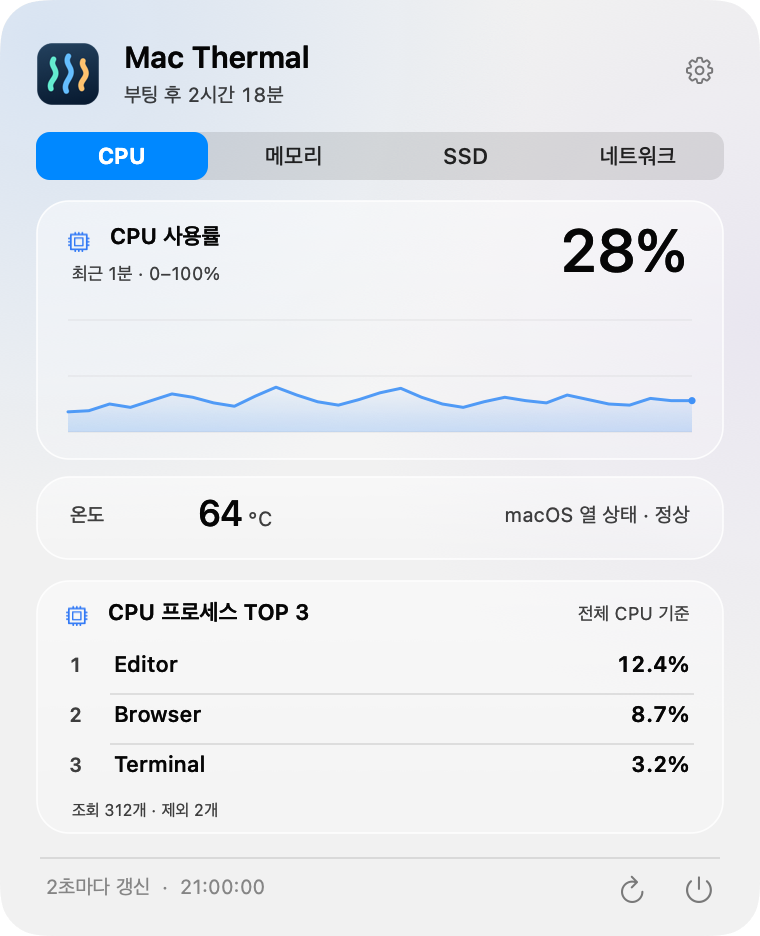

# Mac Thermal

[한국어](README.md) · [English](README.en.md) · **日本語** · [简体中文](README.zh-CN.md)

Macの温度とリソース使用状況を、小さなメニューバーで確認できる無料のオープンソースアプリです。実測値に、さりげない動きを添えています。

**AIを使って制作しました。** コード、UI、翻訳、ドキュメントはOpenAI Codexを活用し、ユーザーとの繰り返しの検討を通じて作成・改善しました。



実際のUIを合成サンプルデータで描画しています。ガラス効果はmacOSのバージョンによって異なります。

## 主な機能

- **メニューバーに表示：** CPU温度・使用率、SSDの読み書き速度、ネットワークのアップロード・ダウンロード速度。
- **動きで伝える指標：** CPUのリズムバーまたは回転する点、転送方向に流れるネットワーク表示、使用容量を液面の高さで、I/O負荷を波の動きで表すSSD表示。
- **リソースごとに確認：** CPU・メモリ・SSD・ネットワークの各タブで使用状況とグラフを確認できます。CPUとメモリのタブには、それぞれ使用量の多い上位3プロセスを表示します。CPU・SSD温度は補助情報として表示し、起動後の経過時間も確認できます。
- **自分好みに設定：** 設定の最上部から韓国語・英語・日本語・中国語（簡体字）をすぐに切り替えられます。動き、強度、ログイン時の自動起動も設定できます。既定の言語は韓国語です。
- **macOSに調和：** ライト・ダークモード、macOS 26のLiquid Glass、「視差効果を減らす」、キーボード操作に対応。
- **ローカルで動作：** アカウント、広告、解析・追跡、サーバーへの送信、管理者権限のヘルパー、ファン制御はありません。

## インストール

**macOS 14以降を搭載したApple Silicon Mac**が必要です。現在の配布ファイルはARM64専用で、Intel Macには対応していません。

1. [最新のDMGをダウンロード](https://github.com/PIYoung/mac-thermal/releases/latest/download/Mac-Thermal-v2.4.0-arm64.dmg)します。
2. DMGを開き、**Mac Thermal.app**を**Applications**フォルダへドラッグします。
3. アプリを起動し、メニューバーの指標をクリックします。Dockアイコンは表示されません。

ZIP版は[リリースページ](https://github.com/PIYoung/mac-thermal/releases/latest)から入手できます。自動更新機能はないため、新しいバージョンはリリースからインストールしてください。

現在のバイナリは**アドホック署名**であり、Apple Developer ID署名・公証は受けていません。ダウンロードしたアプリはmacOS Gatekeeperによってブロックされる場合があります。その場合はセキュリティ設定を無効化せず、以下の手順でソースからビルドしてください。配布ファイルはリリースの`SHA256SUMS`と照合できます。

### ソースからビルド・インストール

Apple Silicon Macと、**macOS 26 SDKを含むXcode 26、または互換性のあるCommand Line Tools**が必要です。実行対象はmacOS 14以降です。macOS 26より前では標準の半透明パネルを使用します。

```sh
git clone https://github.com/PIYoung/mac-thermal.git
cd mac-thermal
zsh scripts/install.sh --open
```

ローカルでビルドし、`~/Applications/Mac Thermal.app`へインストールして起動します。起動せずにインストールする場合は`--open`を省いてください。`sudo`は使用しません。ビルドのみの場合は`zsh build.sh`を実行してください。出力先は`build/Mac Thermal.app`です。

## 使い方

メニューバーをクリックすると、固定サイズのパネルが開きます。右上の**設定**アイコンで設定画面を開閉します。初回はCPUタブを開き、その後は最後に表示したタブを記憶します。言語、選択中のタブ、動きの設定は次回起動時にも引き継がれます。自動起動は**設定 → ログイン時に起動**で管理します。初回起動時に自動登録するのは、ソース用インストールスクリプトの配置先である`~/Applications`から実行した場合のみです。DMGで`/Applications`へインストールした場合は自動登録しません。macOSが承認を求める場合は、システムのログイン項目設定で許可してください。

macOSが熱状態の悪化を報告すると、メニューバーの文字がオレンジまたは赤になります。独自の温度しきい値ではなく、システムの熱状態に基づく表示です。冷却やファン速度の制御は行いません。

## 留意点

- CPU温度は読み取れるコアセンサーの**最高値**で、平均値ではありません。現在は**Apple M4 Proで検証済み**です。他のチップでのセンサー互換性は未確認です。取得できない値は`—`と表示します。
- メモリ温度は表示しません。メモリ使用量・プレッシャー・圧縮・スワップを表示します。
- TOP 3は**プロセス単位**の順位です。同じアプリの複数プロセスを合算しません。CPU使用率は全論理コアを基準に正規化します。
- SSDのI/Oは内蔵物理SSD全体、ネットワーク速度は有効な`en*`インターフェイスが対象です。VPN・ループバックは合算しません。
- 指標は2秒ごとに更新します。グラフはメモリ内だけに保持し、アニメーションは最大8fpsです。

計算方法、単位、互換性の制限については[技術説明](docs/DETAILS.md)をご覧ください。現在、この文書は韓国語で提供しています。

## 貢献とライセンス

不具合、翻訳の修正、機能の提案は[Issues](https://github.com/PIYoung/mac-thermal/issues)へお寄せください。PRを送る場合は[貢献ガイド](CONTRIBUTING.md)をご確認ください。センサーに関する報告にはMacのチップとmacOSのバージョンを添え、個人情報や他のアプリのプロセス名は伏せてください。

プロジェクトのソースコードは[MITライセンス](LICENSE)で公開しています。Statsのセンサープロトコル・キーマッピングを参考にした部分の著作権・MIT表記は[THIRD_PARTY_NOTICES.txt](THIRD_PARTY_NOTICES.txt)に保存しています。アプリアイコン、グラフ、動きは独自に実装し、StatsのUI素材は含めていません。システムが描画するAppleのシンボル・フォントには各提供者の条件が適用されます。[コード・素材の出典](ASSET_PROVENANCE.md)もご確認ください。
