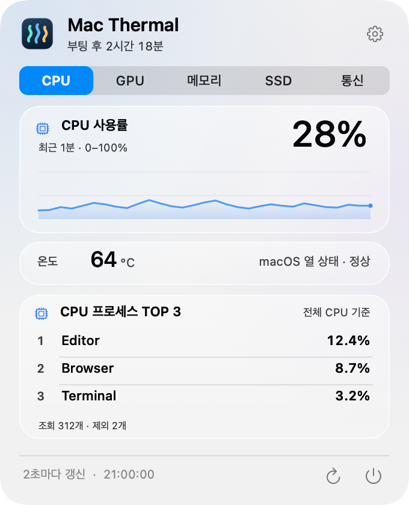
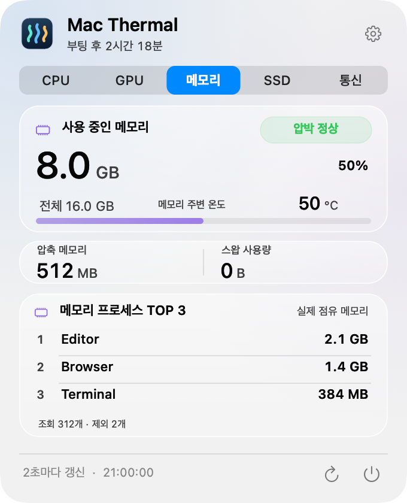
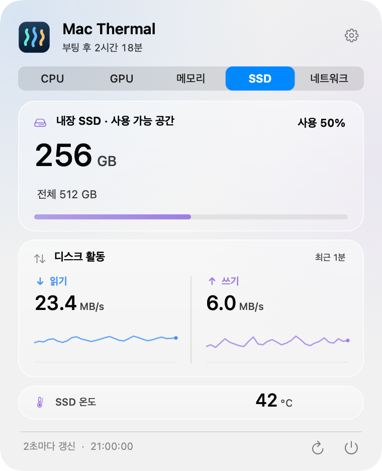
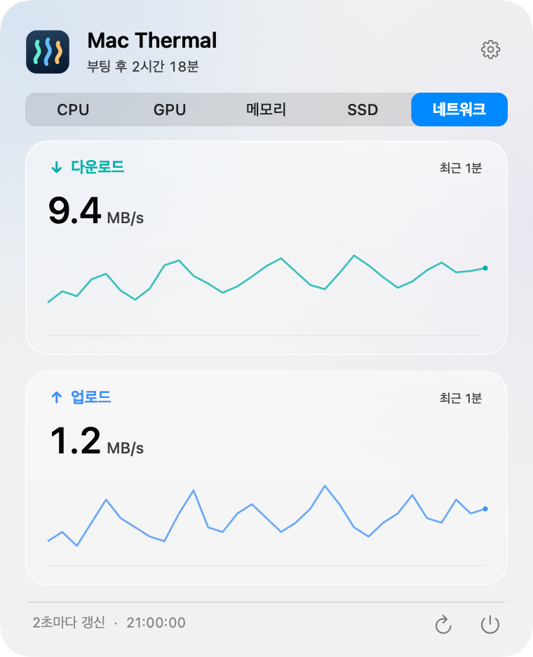
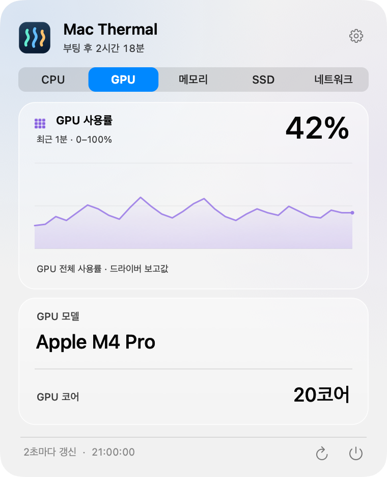

<p align="center">
  
</p>

<h1 align="center">Mac Thermal</h1>

<p align="center">
  <strong>Mac의 상태를, 메뉴바에서 한눈에.</strong><br>
  온도·자원 사용량·전송 속도를 작은 움직임으로 보여주는 무료 오픈소스 앱.
</p>

<p align="center">
  
</p>

<p align="center">
  <strong>한국어</strong> · <a href="README.en.md">English</a> · <a href="README.ja.md">日本語</a> · <a href="README.zh-CN.md">简体中文</a>
</p>

<p align="center">
  <a href="https://github.com/PIYoung/mac-thermal/releases/latest"><strong>↓ 다운로드</strong></a> ·
  <a href="#설치">설치 안내</a> ·
  <a href="RELEASES.md">업데이트 내역</a> ·
  <a href="docs/DETAILS.md">기술 설명</a>
</p>

---

## 메뉴바에서 바로 확인

패널을 열지 않아도 CPU·GPU·SSD·네트워크를 함께 확인할 수 있습니다. 숫자는 실측값이고, 움직임은 지금 얼마나 바쁜지 보여줍니다.

<p align="center">
  <picture>
    <source media="(prefers-reduced-motion: reduce)" srcset="docs/images/menubar.png">
    
  </picture>
  <br>
  <sub>실제 앱의 렌더러로 만든 합성 예시입니다. <a href="docs/images/menubar.png">정지 이미지 보기</a></sub>
</p>

| CPU의 리듬 | SSD의 물결 | 네트워크의 흐름 |
| :--- | :--- | :--- |
| 온도·사용률을 표시하고, 바쁜 정도에 따라 막대가 움직입니다. 순환 점 스타일도 선택할 수 있습니다. | 읽기·쓰기 속도를 표시합니다. 채움 높이는 사용 용량, 물결은 I/O 활동을 나타냅니다. | 업로드·다운로드 속도와 방향을 흐름으로 표현합니다. 전송이 없으면 흐름도 멈춥니다. |

열 상태에 따라 메뉴바 글자가 **주황색·빨간색**으로 바뀝니다. 설정에서 움직임을 끄거나 강도를 조절할 수 있고, macOS의 **동작 줄이기**도 따릅니다.

기본 메뉴바는 **CPU·GPU·SSD·네트워크 4개 항목을 모두 표시**합니다. 설정의 **메뉴바 표시**에서 보고 싶은 항목만 개별 체크할 수 있습니다. 항목 사이와 SSD·네트워크 사이 간격을 촘촘하게 맞추고, 숨긴 항목의 자리도 함께 줄입니다. 사용률이 높을수록 켜지는 칸과 빛의 흐름이 빨라지고, 0%에서는 멈춥니다. 12칸은 사용률 눈금이며 실제 GPU 코어 수가 아닙니다.

<p align="center">
  <picture>
    <source media="(prefers-reduced-motion: reduce)" srcset="docs/images/menubar-gpu.png">
    
  </picture>
</p>

## 클릭하면 자원별로 자세히

메뉴바를 누르면 고정 크기 패널이 열립니다. 처음에는 CPU, 그다음부터는 마지막으로 본 탭이 열립니다. 이미지를 클릭하면 크게 볼 수 있습니다.

<table>
  <tr>
    <th>CPU</th>
    <th>메모리</th>
  </tr>
  <tr>
    <td align="center">
      <a href="docs/images/panel-ko-cpu.png"></a><br>
      <sub>사용률 그래프 · 온도 · 프로세스 TOP 3</sub>
    </td>
    <td align="center">
      <a href="docs/images/panel-ko-memory.png"></a><br>
      <sub>메모리 압박 · 압축·스왑 · 프로세스 TOP 3</sub>
    </td>
  </tr>
  <tr>
    <th>SSD</th>
    <th>네트워크</th>
  </tr>
  <tr>
    <td align="center">
      <a href="docs/images/panel-ko-ssd.png"></a><br>
      <sub>남은 공간 · 읽기·쓰기 그래프 · 온도</sub>
    </td>
    <td align="center">
      <a href="docs/images/panel-ko-network.png"></a><br>
      <sub>다운로드·업로드 · 최근 1분 그래프</sub>
    </td>
  </tr>
  <tr><th colspan="2">GPU</th></tr>
  <tr><td colspan="2" align="center">
    <a href="docs/images/panel-ko-gpu.png"></a><br>
    <sub>사용률 그래프 · GPU 모델 · 코어 수</sub>
  </td></tr>
</table>

<sub>모든 미리보기는 합성 예시 데이터입니다. macOS 버전에 따라 유리 효과가 다를 수 있습니다.</sub>

**한국어 기본 · 4개 언어 · 밝은/어두운 모드 · 부팅 후 경과 시간 · 로그인 시 자동 실행**<br>
오른쪽 위 설정 버튼에서 언어와 메뉴바 움직임, 자동 실행을 바꿀 수 있습니다. 계정·광고·분석·서버 전송 없이 동작하며, 그래프 기록은 메모리에만 유지합니다.

## 디스크 정리

SSD 카드 오른쪽 위의 **디스크 정리**에서 클라우드와 동기화되지 않는 로컬 폴더를 처음 한 번 선택합니다. 선택한 폴더를 기억해 다음 정리 화면 진입 때 자동 검사합니다. 폴더 관리에서 변경하거나 기억을 해제할 수 있습니다. 생성·수정 시점이 모두 30일 이상 지난 DMG·PKG 설치 파일과 100MB 이상인 파일을 후보로 보여줍니다. 파일이 크거나 오래됐다는 이유만으로 불필요하다고 판단하지 않으며, 전체 검사를 마치면 오래된 설치 파일만 추천 체크하고 대용량 파일은 직접 선택하도록 둡니다. 중지·한도 초과 결과는 자동 체크하지 않습니다.

파일별 위치·용량·수정일·후보 이유를 확인하고, 선택한 개수와 용량을 검토한 뒤 **휴지통으로 이동**합니다. 시스템·알려진 클라우드 위치·숨김 파일·심볼릭 링크·패키지 내부·버전 관리 프로젝트와 전체 캐시는 자동 정리하지 않습니다. 검색·진행 중지를 지원하며 결과에서 성공·건너뜀·실패를 구분합니다.

휴지통으로 이동한 용량은 확보한 공간이 아닙니다. 앱은 휴지통을 자동으로 비우거나 영구 삭제하지 않으며, 결과에서 휴지통을 열어 확인할 수 있습니다. 임의 위치의 제3자 동기화 폴더는 모두 식별할 수 없으므로 직접 제외해야 합니다. 선택한 폴더의 북마크와 식별 정보만 로컬에 저장하고, 이동·교체 등으로 확인할 수 없으면 다시 선택해야 합니다. 후보 목록·체크 상태·확인 내역은 메모리에만 유지하고 파일 내용을 읽거나 서버로 보내지 않습니다.

## 설치

**Apple Silicon Mac · macOS 14 이상**에서 실행됩니다. 배포 파일은 ARM64 전용이며 Intel Mac은 지원하지 않습니다.

1. [최신 릴리즈](https://github.com/PIYoung/mac-thermal/releases/latest)에서 **DMG**를 다운로드합니다. ZIP도 제공합니다.
2. DMG를 열고 **Mac Thermal.app**을 **Applications** 폴더로 드래그합니다.
3. 앱을 실행한 뒤 메뉴바의 지표를 클릭합니다. Dock 아이콘은 표시하지 않습니다.

> **다운로드 전 확인** — 현재 앱은 ad-hoc 서명이며 Apple Developer ID 서명·공증을 받지 않았습니다. macOS가 실행을 차단하면 보안 설정을 해제하지 말고 아래 소스 빌드 방법을 사용하세요. 파일의 무결성은 릴리즈의 `SHA256SUMS`와 대조할 수 있습니다.

자동 업데이트 기능은 없습니다. 새 버전은 [릴리즈 페이지](https://github.com/PIYoung/mac-thermal/releases)에서 설치합니다.

<details>
<summary><strong>소스에서 빌드·설치하기</strong></summary>

Apple Silicon과 **macOS 26 SDK를 포함한 Xcode 26 또는 호환 Command Line Tools**가 필요합니다. 실행 대상은 macOS 14 이상이며, macOS 26 이전에는 표준 반투명 패널을 사용합니다.

```sh
git clone https://github.com/PIYoung/mac-thermal.git
cd mac-thermal
zsh scripts/install.sh --open
```

`~/Applications/Mac Thermal.app`에 설치하고 실행합니다. `--open`을 빼면 설치만 합니다. `sudo`는 사용하지 않습니다. 빌드만 하려면 `zsh build.sh`를 실행하세요. 결과는 `build/Mac Thermal.app`입니다.

</details>

<details>
<summary><strong>자동 실행과 표시 기준 알아보기</strong></summary>

- **로그인 시 자동 실행:** 설정에서 켜고 끕니다. `~/Applications`에서 실행할 때만 첫 실행 시 자동 등록하며, DMG로 `/Applications`에 설치한 경우에는 자동 등록하지 않습니다. macOS가 승인을 요청하면 시스템 로그인 항목에서 허용해야 합니다.
- **GPU:** 드라이버가 보고하는 전체 사용률·모델·코어 수를 표시합니다. Apple M4 Pro에서 실측을 확인했으며, 칩·macOS별 호환성은 다를 수 있습니다. 읽을 수 없으면 메뉴바는 `—`, 패널은 `정보 없음`으로 표시합니다. GPU 온도·NPU 사용률은 제공하지 않습니다.
- **CPU 온도:** 읽을 수 있는 코어 센서의 최댓값입니다. Apple M4 Pro에서 센서 읽기를 검증했으며 다른 칩의 호환성은 미확인입니다. 조회할 수 없는 값은 `—`로 표시합니다.
- **열 상태:** macOS가 보고한 상태를 사용합니다. 임의의 온도 임계값으로 판단하지 않으며 팬·냉각을 제어하지 않습니다.
- **메모리:** 사용량·압박·압축·스왑을 표시합니다. 메모리 온도는 제공하지 않습니다.
- **TOP 3:** 앱의 프로세스를 합산하지 않는 프로세스별 순위입니다. CPU 비율은 전체 논리 코어 기준입니다.
- **SSD·네트워크:** SSD I/O는 내부 물리 SSD 전체, 네트워크는 활성 `en*` 인터페이스 기준입니다. VPN·loopback은 합산하지 않습니다.
- **갱신:** 2초마다 측정하며 움직임은 최대 8fps입니다. 사용자 설정·동작 줄이기·잠자기·화면 꺼짐·유휴 상태에 맞춰 움직임을 멈춥니다.

계산 방법과 호환성의 자세한 범위는 [기술 설명](docs/DETAILS.md)을 확인하세요.

</details>

## 함께 만들기

**AI로 제작했습니다.** 코드·UI·번역·문서는 OpenAI Codex와 사용자의 반복적인 피드백으로 만들었습니다.

[버그·기능 제안](https://github.com/PIYoung/mac-thermal/issues) · [기여 안내](CONTRIBUTING.md) · [보안 제보](SECURITY.md)

센서 문제는 Mac 칩과 macOS 버전을 함께 알려 주세요. 화면·로그를 공유할 때는 개인 정보와 다른 앱의 프로세스 이름을 가려 주세요.

[MIT 라이선스](LICENSE)로 배포합니다. Stats 센서 참고 부분의 저작권·MIT 허가문은 [타사 고지](THIRD_PARTY_NOTICES.txt)에 보존합니다. 앱 아이콘·UI·그래프·움직임은 자체 구현이며, 시스템 심볼·글꼴에는 해당 제공자의 조건이 적용됩니다. [코드·자산 출처](ASSET_PROVENANCE.md)

<sub>README 구성 참고: <a href="https://github.com/othneildrew/Best-README-Template">Best-README-Template</a> (Unlicense). 소개 문구와 이미지는 이 프로젝트에서 직접 작성했습니다.</sub>
