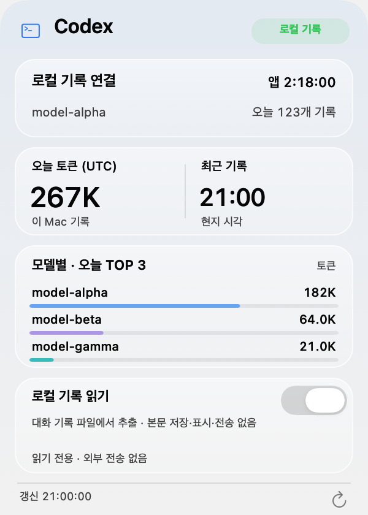

<p align="center"></p>
<h1 align="center">Mac Thermal</h1>
<p align="center"><strong>Mac의 상태를, 메뉴바에서 한눈에.</strong><br>Apple Silicon · macOS 14+ · MIT</p>
<p align="center"><strong>한국어</strong> · <a href="README.en.md">English</a> · <a href="README.ja.md">日本語</a> · <a href="README.zh-CN.md">简体中文</a></p>
<p align="center"><a href="https://github.com/PIYoung/mac-thermal/releases/latest"><strong>↓ 다운로드</strong></a> · <a href="RELEASES.md">업데이트</a></p>

## 메뉴바와 패널

<p align="center"></p>
<table align="center">
  <tr><th>Codex 보조 패널</th><th>자원 패널</th></tr>
  <tr>
    <td><a href="docs/images/codex-ko-light.png"></a></td>
    <td><a href="docs/images/panel-ko-cpu.png"></a></td>
  </tr>
</table>
<sub>합성 예시를 실제 앱 렌더러로 그렸습니다. macOS에 따라 반투명 효과가 다를 수 있습니다.</sub>

## 주요 기능

- **메뉴바:** CPU 온도·사용률, GPU 사용률, SSD 읽기·쓰기, 네트워크 속도와 움직이는 지표.
- **클릭 패널:** CPU·GPU·메모리·SSD·통신 탭, 최근 그래프, CPU·메모리 프로세스 TOP 3, 부팅 후 경과 시간.
- **온도와 팬:** CPU·GPU·SSD 온도와 메모리 **주변 온도**, 항목별 독립 경고색, CPU 패널의 팬 상태·실측 RPM. 센서 지원은 기기에 따라 다릅니다.
- **상태 안내·AI 설명:** 각 자원 탭에서 측정 근거와 해볼 일을 확인합니다. 지원되는 macOS 26+에서는 요청할 때만 Apple 온디바이스 모델로 짧게 설명하며, 미지원·고온 상태에서는 기본 안내를 제공합니다.
- **Codex:** 왼쪽 보조 패널에 오늘 로컬 토큰·입력/출력·캐시 재사용·모델 TOP 3. 선택적으로 계정 한도와 활동 요약을 연결하며, 얇은 커스텀 스크롤바로 카드를 함께 탐색합니다.
- **디스크 정리:** 폴더 지정 없이 홈 폴더를 자동 검사. 후보를 직접 선택하고 최종 확인 후 휴지통으로 이동. 특정 폴더 검사도 지원.
- **설정:** 표시 항목·움직임·로그인 시 자동 실행. 한국어 기본, 영어·일본어·중국어 간체 지원.

## 설치

1. [최신 릴리즈](https://github.com/PIYoung/mac-thermal/releases/latest)에서 **DMG**를 다운로드합니다. ZIP도 제공합니다.
2. DMG를 열고 **Mac Thermal.app**을 **Applications** 폴더로 드래그합니다.
3. 앱을 실행하고 메뉴바를 클릭합니다. 업데이트는 새 릴리즈를 설치합니다.

> 현재 빌드는 ad-hoc 서명이며 Apple 공증을 받지 않았습니다. macOS가 차단하면 보안 설정을 해제하지 말고 아래 소스 빌드를 이용하세요. 배포 파일은 `SHA256SUMS`로 검증할 수 있습니다.

<details>
<summary>소스에서 빌드·설치</summary>

Apple Silicon과 macOS 26 SDK를 포함한 Xcode 26 또는 호환 Command Line Tools가 필요합니다.

```sh
git clone https://github.com/PIYoung/mac-thermal.git
cd mac-thermal
zsh scripts/install.sh --open
```

기존 앱을 종료한 뒤 실행하면 `~/Applications`에 설치합니다. `sudo`는 필요 없습니다.

</details>

## Codex 기록과 개인정보

Codex 기록 읽기는 **기본 OFF**입니다. 켜면 `~/.codex/sessions`에서 모델명·토큰 숫자·시각만 메모리에 집계합니다. 파일에는 대화 본문도 있지만 본문·명령·인증정보를 보관·표시·전송하지 않으며 원본을 수정하지 않습니다. 끄면 읽기와 집계를 중지합니다.

사용량은 **이 Mac의 오늘 기록(UTC)**입니다. 계정 전체 사용량·청구 금액은 아닙니다. 선택적인 [공식 로그인 연결](docs/CODEX_ACCOUNT.md)은 별도 동의 후 계정 잔여율·리셋 카운트다운을 표시합니다. 날짜별 숫자 요약과 누적 토큰·연속 사용일 등의 계정 요약도 각각 추가 동의가 필요합니다. 개발자 수집 서버·분석 SDK·원격 로그 업로드는 없습니다. 로봇은 새 기록 감지 후 추가 기록이 없으면 10초 뒤 멈추며, 실시간 토큰 소비나 작업 완료 상태를 뜻하지 않습니다.

한도 리셋 알림은 설정에서 선택적으로 켤 수 있습니다(기본 OFF). 앱 실행·계정 연결 중 서버의 갱신을 확인하면 한 번 알리며, macOS 알림 권한이 필요합니다. 추가 조회나 데이터 수집은 없습니다.

---

[기술 설명](docs/DETAILS.md) · [보안](SECURITY.md) · [기여](CONTRIBUTING.md) · [MIT 라이선스](LICENSE) · [타사 고지](THIRD_PARTY_NOTICES.txt)

<sub>OpenAI Codex와 사용자 피드백으로 제작한 AI 활용 프로젝트입니다.</sub>
