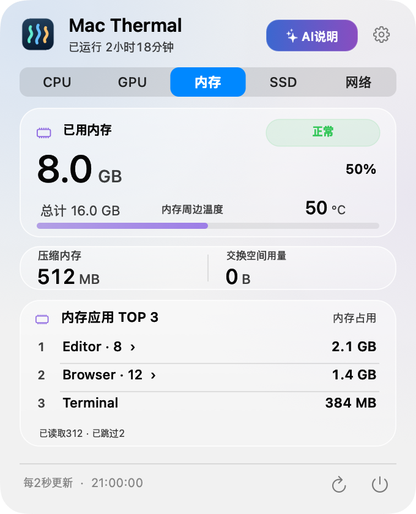
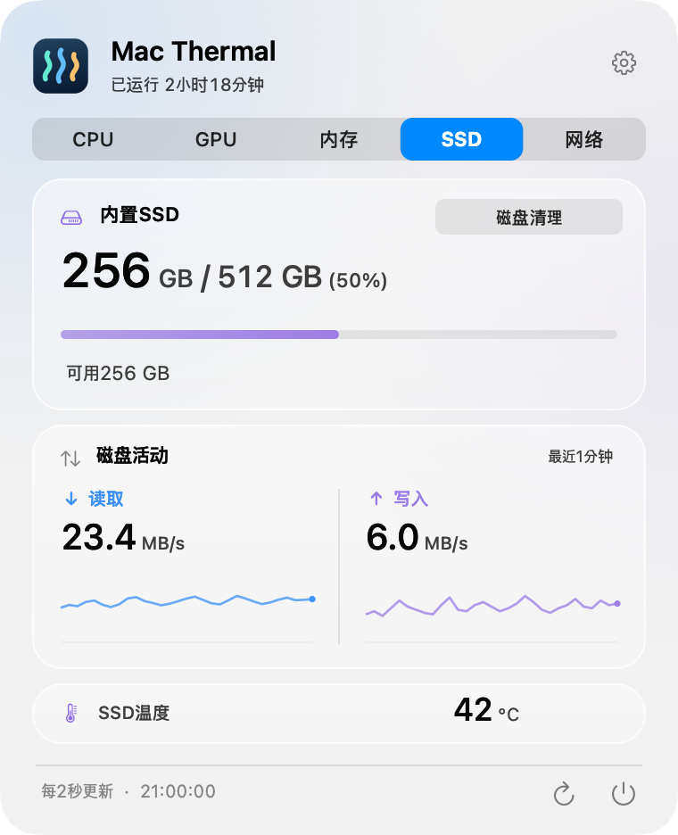
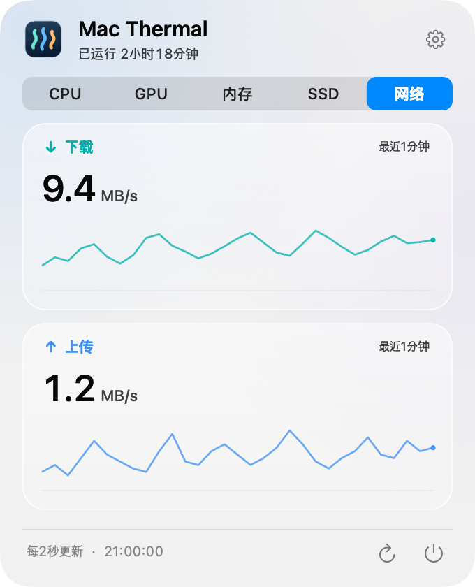
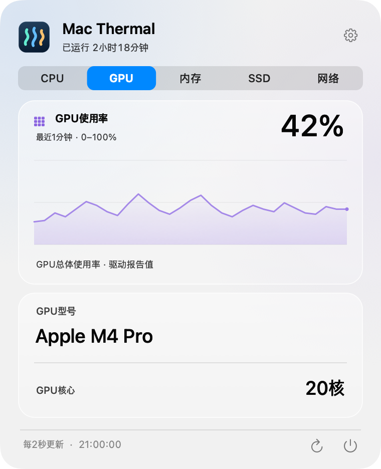

<p align="center">
  
</p>

<h1 align="center">Mac Thermal</h1>

<p align="center">
  <strong>在菜单栏，一眼看清 Mac 的状态。</strong><br>
  用轻巧的动态效果呈现温度、资源使用量与传输速度的免费开源应用。
</p>

<p align="center">
  
</p>

<p align="center">
  <a href="README.md">한국어</a> · <a href="README.en.md">English</a> · <a href="README.ja.md">日本語</a> · <strong>简体中文</strong>
</p>

<p align="center">
  <a href="https://github.com/PIYoung/mac-thermal/releases/latest"><strong>↓ 下载</strong></a> ·
  <a href="#安装">安装指南</a> ·
  <a href="RELEASES.md">更新记录</a> ·
  <a href="docs/DETAILS.md">技术说明</a>
</p>

---

## 在菜单栏随时查看

无需一直打开面板，就能同时查看 CPU、GPU、SSD 和网络状态。数字来自实际测量，动态效果则让忙碌程度一目了然。

<p align="center">
  <picture>
    <source media="(prefers-reduced-motion: reduce)" srcset="docs/images/menubar.png">
    
  </picture>
  <br>
  <sub>使用实际应用的渲染器和合成示例数据生成。<a href="docs/images/menubar.png">查看静态图片</a></sub>
</p>

| CPU 节奏 | SSD 波浪 | 网络流动 |
| :--- | :--- | :--- |
| 显示温度与使用率，节奏条随负载变化。也可选择环绕圆点样式。 | 显示读写速度。液面高度表示已用容量，波浪表示 I/O 活动。 | 分别呈现上传与下载的速度和方向。没有传输时，对应的流动效果也会停止。 |

菜单栏文字会随系统热状态变为**橙色或红色**。可以在设置中关闭动态效果或调整强度，也会遵循 macOS 的**减弱动态效果**设置。

菜单栏默认**同时显示CPU、GPU、SSD和网络四项**。在**设置 → 菜单栏指标**中逐项勾选想查看的内容。各组按内容紧凑排列，缩短SSD与网络间距，隐藏项目不会留下空位。使用率越高，点亮的格子越多，柔和光波的速度也越快；0%时静止。12格表示使用率刻度，并非实际核心数量。

<p align="center">
  <picture>
    <source media="(prefers-reduced-motion: reduce)" srcset="docs/images/menubar-gpu.png">
    
  </picture>
</p>

## 点击查看各项资源详情

点击菜单栏即可打开固定大小的面板。首次打开 CPU 页，之后会记住上次查看的标签页。点击图片可查看大图。

<table>
  <tr>
    <th>CPU</th>
    <th>内存</th>
  </tr>
  <tr>
    <td align="center">
      <a href="docs/images/panel-zh-CN-cpu.png"></a><br>
      <sub>使用率图表 · 温度 · 进程 TOP 3</sub>
    </td>
    <td align="center">
      <a href="docs/images/panel-zh-CN-memory.png"></a><br>
      <sub>内存压力 · 压缩与交换空间 · 进程 TOP 3</sub>
    </td>
  </tr>
  <tr>
    <th>SSD</th>
    <th>网络</th>
  </tr>
  <tr>
    <td align="center">
      <a href="docs/images/panel-zh-CN-ssd.png"></a><br>
      <sub>可用空间 · 读写速度图表 · 温度</sub>
    </td>
    <td align="center">
      <a href="docs/images/panel-zh-CN-network.png"></a><br>
      <sub>下载与上传 · 最近 1 分钟图表</sub>
    </td>
  </tr>
  <tr><th colspan="2">GPU</th></tr>
  <tr><td colspan="2" align="center">
    <a href="docs/images/panel-zh-CN-gpu.png"></a><br>
    <sub>使用率图表 · GPU型号 · 核心数量</sub>
  </td></tr>
</table>

<sub>所有预览均使用合成示例数据。玻璃效果可能因 macOS 版本而异。</sub>

**默认韩语 · 四种语言 · 浅色与深色外观 · 开机时长 · 登录时自动启动**<br>
右上角的设置按钮可调整语言、菜单栏动态效果和自动启动。无需账号，无广告、分析或服务器上传；图表记录仅保留在内存中。

## 磁盘清理

通过SSD卡片右上角的**磁盘清理**选择未与云端同步的本地文件夹。应用会列出创建和修改日期都至少在30天前的DMG/PKG安装文件，以及符合相同日期条件且至少100MB的文件。文件较旧或较大不代表没有用，所有项目默认不勾选。

查看每个文件的位置、大小、修改日期和候选原因，确认选中数量与容量后，再**移到废纸篓**。系统和已知云端位置、隐藏文件、符号链接、软件包内部、版本控制项目，以及批量清除缓存均不在范围内。支持停止搜索或后续移动，结果会分别显示已移动、已跳过和失败项目。

移到废纸篓的大小不等于已释放空间。应用不会清空废纸篓或永久删除文件；可从结果页面打开废纸篓检查。无法识别所有位于任意位置的第三方同步文件夹，请勿选择这些文件夹。候选列表仅保留在内存中，不读取文件内容，也不上传数据。

## 安装

需要 **Apple Silicon Mac，运行 macOS 14 或更新版本**。发布包仅支持 ARM64，不支持 Intel Mac。

1. 从[最新发布页面](https://github.com/PIYoung/mac-thermal/releases/latest)下载 **DMG**。也提供 ZIP。
2. 打开 DMG，将 **Mac Thermal.app** 拖入 **Applications** 文件夹。
3. 启动应用，点击菜单栏中的指标。应用不显示 Dock 图标。

> **下载前须知** — 当前应用采用 ad-hoc 签名，尚未使用 Apple Developer ID 签名或通过 Apple 公证。如果 macOS 阻止运行，请勿关闭系统安全设置，可按下方说明从源码构建。下载文件可与发布页面的 `SHA256SUMS` 对照校验。

应用没有自动更新功能。新版本需从[发布页面](https://github.com/PIYoung/mac-thermal/releases)安装。

<details>
<summary><strong>从源码构建并安装</strong></summary>

需要 Apple Silicon，以及**包含 macOS 26 SDK 的 Xcode 26 或兼容的 Command Line Tools**。运行目标为 macOS 14 或更新版本；在 macOS 26 之前的系统上使用标准半透明面板。

```sh
git clone https://github.com/PIYoung/mac-thermal.git
cd mac-thermal
zsh scripts/install.sh --open
```

安装到 `~/Applications/Mac Thermal.app` 并启动。省略 `--open` 则只安装。不使用 `sudo`。若只需构建，请运行 `zsh build.sh`，输出为 `build/Mac Thermal.app`。

</details>

<details>
<summary><strong>自动启动与数据口径</strong></summary>

- **登录时自动启动：** 可在设置中开关。仅从 `~/Applications` 运行时，应用才会在首次启动时自动注册；通过 DMG 安装到 `/Applications` 时不会自动注册。如果 macOS 要求批准，请在系统的登录项设置中允许。
- **GPU：** 显示驱动报告的总体使用率、型号与核心数量。已在Apple M4 Pro上验证实际读取；兼容性会因芯片和macOS而异。无法读取时，菜单栏显示`—`，面板显示“无数据”。不提供GPU温度或NPU使用率。
- **CPU 温度：** 可读取核心传感器中的最高值。已在 Apple M4 Pro 上验证传感器读取，其他芯片的兼容性尚未确认。无法读取的数据会显示为 `—`。
- **热状态：** 使用 macOS 报告的状态，不按自定温度阈值判断，也不控制风扇或散热。
- **内存：** 显示使用量、压力、压缩与交换空间，不提供内存温度。
- **TOP 3：** 按进程排名，不合并同一应用的多个进程。CPU 百分比按全部逻辑核心归一化。
- **SSD 与网络：** SSD I/O 覆盖整个内置物理 SSD；网络统计有效的 `en*` 接口，不包含 VPN 或回环接口。
- **刷新：** 每 2 秒测量一次，动态效果最高为 8fps。根据用户设置、减弱动态效果、睡眠、屏幕关闭和空闲状态停止动画。

计算方法与兼容范围详见[技术说明](docs/DETAILS.md)，该文档目前以韩语提供。

</details>

## 一起完善

**使用 AI 制作。** 代码、UI、翻译和文档由 OpenAI Codex 与用户通过多轮反馈共同完成。

[问题与功能建议](https://github.com/PIYoung/mac-thermal/issues) · [贡献指南](CONTRIBUTING.md) · [安全问题报告](SECURITY.md)

报告传感器问题时，请附上 Mac 芯片与 macOS 版本。分享截图或日志前，请遮盖个人信息和其他应用的进程名称。

项目以 [MIT 许可证](LICENSE)发布。参考 Stats 传感器实现的部分，其版权与 MIT 许可声明保留在[第三方声明](THIRD_PARTY_NOTICES.txt)中。应用图标、UI、图表与动态效果均为独立实现；系统符号与字体受各提供方的条款约束。[代码与素材来源](ASSET_PROVENANCE.md)

<sub>README 布局参考：<a href="https://github.com/othneildrew/Best-README-Template">Best-README-Template</a>（Unlicense）。介绍文案和图片均由本项目制作。</sub>
