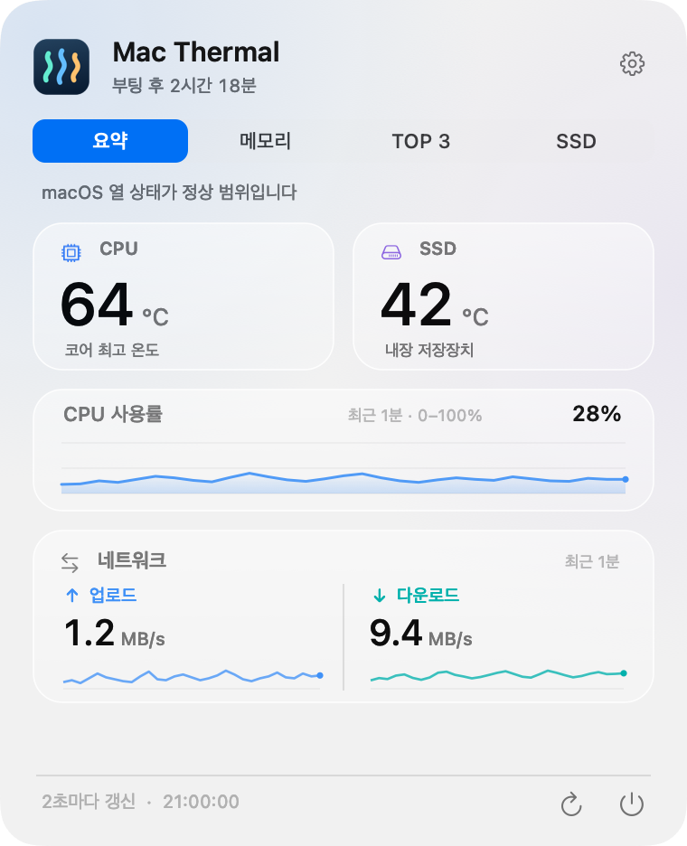

# Mac Thermal

[한국어](README.md) · [English](README.en.md) · [日本語](README.ja.md) · **简体中文**

一款免费的开源菜单栏应用，让你随时查看 Mac 的温度与资源使用情况。数据来自实际测量，配上轻巧的动态效果。

**使用 AI 制作。** 代码、UI、翻译和文档借助 OpenAI Codex 编写，并根据用户的多轮反馈不断改进。



使用合成示例数据渲染实际界面。玻璃效果会因macOS版本而异。

## 主要功能

- **菜单栏实时显示：** CPU 温度与使用率、SSD 读写速度、网络上传与下载速度。
- **动态指标：** CPU 节奏条或环绕圆点、沿传输方向流动的网络效果，以及用液面高度表示已用容量、用波浪速度表示 I/O 活动的 SSD 图标。
- **点击查看详情：** 概览、内存压力与交换空间、CPU 和内存占用最高的 3 个进程、SSD 活动与容量，以及开机时长。
- **按需设置：** 在设置顶部即时切换韩语、英语、日语和简体中文，也可调整动画、强度和登录时自动启动。默认语言为韩语。
- **融入 macOS：** 支持浅色与深色外观、macOS 26 的 Liquid Glass、减弱动态效果和键盘操作。
- **仅在本地运行：** 无账号、广告、分析或跟踪、服务器上传、管理员辅助程序，也不控制风扇。

## 安装

需要 **Apple Silicon Mac，运行 macOS 14 或更新版本**。当前发布包仅支持 ARM64，不支持 Intel Mac。

1. [下载最新 DMG](https://github.com/PIYoung/mac-thermal/releases/latest/download/Mac-Thermal-v2.3.0-arm64.dmg)。
2. 打开 DMG，将 **Mac Thermal.app** 拖入 **Applications** 文件夹。
3. 启动应用，点击菜单栏中的指标。应用不显示 Dock 图标。

也可以在[发布页面](https://github.com/PIYoung/mac-thermal/releases/latest)下载 ZIP。应用没有自动更新功能，新版本需从发布页面安装。

当前二进制文件采用 **ad-hoc 签名**，尚未使用 Apple Developer ID 签名或通过 Apple 公证。下载的应用可能会被 macOS Gatekeeper 阻止。如果无法打开，请按下方说明从源码构建，不要关闭系统安全设置。可通过发布页面的 `SHA256SUMS` 校验下载文件。

### 从源码构建并安装

需要 Apple Silicon Mac，以及**包含 macOS 26 SDK 的 Xcode 26，或兼容的 Command Line Tools**。应用的运行目标为 macOS 14 或更新版本；在 macOS 26 之前的系统上使用标准半透明面板。

```sh
git clone https://github.com/PIYoung/mac-thermal.git
cd mac-thermal
zsh scripts/install.sh --open
```

脚本在本地构建并安装到 `~/Applications/Mac Thermal.app`，然后启动应用。若只安装而不启动，请省略 `--open`。无需 `sudo`。若只需构建，请运行 `zsh build.sh`，输出为 `build/Mac Thermal.app`。

## 使用

点击菜单栏即可打开固定大小的面板。右上角的**设置**图标用于打开或关闭设置。语言、所选标签页和动画设置会在下次启动时保留。请在**设置 → 登录时启动**中管理自动启动。只有从源码安装脚本的目标目录 `~/Applications` 运行时，应用才会在首次启动时自动注册。通过 DMG 安装到 `/Applications` 时不会自动注册。如果 macOS 要求批准，请在系统的登录项设置中允许。

当 macOS 报告热状态升高时，菜单栏文字会变为橙色或红色。该状态来自系统热状态，而非自行设定的温度阈值。应用不调节散热或风扇转速。

## 使用前须知

- CPU 温度是可读取核心传感器中的**最高值**，不是平均值。目前已在 **Apple M4 Pro 上验证**；其他芯片的传感器兼容性尚未确认。无法读取的数据会显示为 `—`。
- 不提供内存温度，内存页显示使用量、压力、压缩和交换空间。
- TOP 3 按**进程**排名，不合并同一应用的多个进程。CPU 百分比按全部逻辑核心归一化。
- SSD I/O 统计覆盖整个内置物理 SSD。网络速度统计有效的 `en*` 接口，不包含 VPN 或回环接口。
- 每 2 秒采集一次数据。图表仅保留在内存中，动画最高为 8fps。

计算方法、单位与兼容性限制详见[技术说明](docs/DETAILS.md)。该文档目前以韩语提供。

## 贡献与许可证

欢迎通过 [Issues](https://github.com/PIYoung/mac-thermal/issues) 提交问题、翻译修正和功能建议，提交 PR 前请阅读[贡献指南](CONTRIBUTING.md)。报告传感器问题时，请附上 Mac 芯片与 macOS 版本，并遮盖个人信息和其他应用的进程名称。

项目源码以 [MIT 许可证](LICENSE)发布。参考 Stats 传感器协议及键映射部分的版权与 MIT 声明保留在 [THIRD_PARTY_NOTICES.txt](THIRD_PARTY_NOTICES.txt) 中。应用图标、图表和动态效果均为独立实现，不包含 Stats 的 UI 素材。由系统渲染的 Apple 符号与字体仍受各提供方的条款约束。请参阅[代码与素材来源](ASSET_PROVENANCE.md)。
