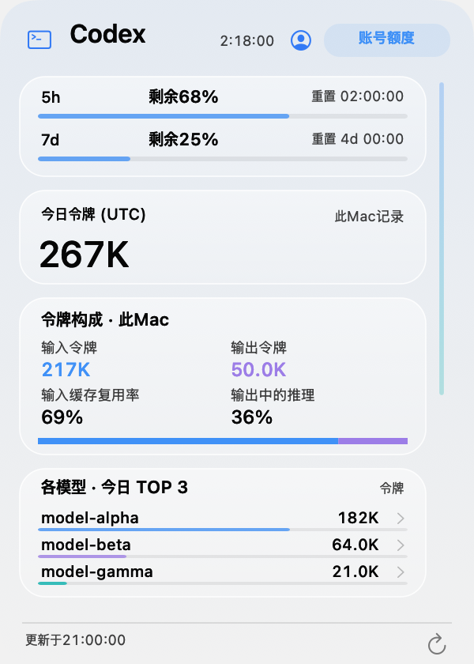
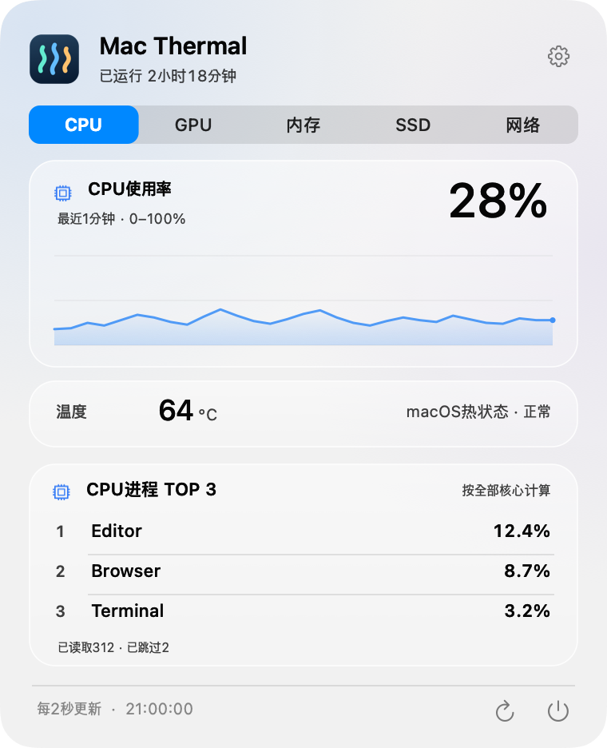

<p align="center"></p>
<h1 align="center">Mac Thermal</h1>
<p align="center"><strong>在菜单栏，一眼了解Mac状态。</strong><br>Apple Silicon · macOS 14+ · MIT</p>
<p align="center"><a href="README.md">한국어</a> · <a href="README.en.md">English</a> · <a href="README.ja.md">日本語</a> · <strong>简体中文</strong></p>
<p align="center"><a href="https://github.com/PIYoung/mac-thermal/releases/latest"><strong>↓ 下载</strong></a> · <a href="RELEASES.md">更新记录</a></p>

## 菜单栏与面板

<p align="center"></p>
<table align="center">
  <tr><th>Codex辅助面板</th><th>资源面板</th></tr>
  <tr>
    <td><a href="docs/images/codex-zh-CN-light.png"></a></td>
    <td><a href="docs/images/panel-zh-CN-cpu.png"></a></td>
  </tr>
</table>
<sub>由实际应用渲染器绘制的合成示例，半透明效果因macOS版本而异。</sub>

## 主要功能

- **菜单栏：** CPU温度与使用率、GPU使用率、SSD读写、网络速度及动画指示器。
- **点击面板：** CPU、GPU、内存、SSD、网络标签，近期图表，CPU/内存占用最高的3个进程及系统运行时长。
- **Codex：** 左侧辅助面板显示今日本地令牌、输入/输出、缓存复用率和模型TOP 3。可选连接账号额度和活动摘要，通过纤细的原创滚动条一起浏览卡片。
- **磁盘清理：** 无需指定文件夹即可扫描主文件夹。自行选择候选文件，最终确认后移到废纸篓。也支持仅扫描指定文件夹。
- **设置：** 自选指标、动画及登录时启动。默认韩语，支持英语、日语及简体中文。

## 安装

1. 从[最新发布](https://github.com/PIYoung/mac-thermal/releases/latest)下载**DMG**，也提供ZIP。
2. 打开DMG，将**Mac Thermal.app**拖入**Applications**。
3. 启动后点击菜单栏。更新时安装新的发布版本。

> 此构建采用ad-hoc签名，未经Apple公证。如果macOS阻止运行，请勿关闭安全设置，可按下方说明从源码构建。下载文件可与`SHA256SUMS`核对。

<details>
<summary>从源码构建并安装</summary>

需要Apple Silicon，以及包含macOS 26 SDK的Xcode 26或兼容Command Line Tools。

```sh
git clone https://github.com/PIYoung/mac-thermal.git
cd mac-thermal
zsh scripts/install.sh --open
```

请先退出已运行的应用。安装到`~/Applications`，无需`sudo`。

</details>

## Codex记录与隐私

Codex记录读取**默认关闭**。开启后，仅从`~/.codex/sessions`提取模型名、令牌数字和时间，在内存中统计。这些文件也包含对话正文，但不会保留、显示或传输正文、命令和凭据，不修改原文件。关闭后停止读取并清除统计。

用量仅涵盖**此Mac今日记录（UTC）**，并非整个账号的用量或账单。可选的[官方登录连接](docs/CODEX_ACCOUNT.md)需单独同意，才会显示账号剩余额度和重置倒计时。每日数字摘要和累计令牌、连续使用天数等账号摘要，也分别需要额外同意。没有开发者数据收集服务器、分析SDK或远程日志上传。10秒内没有新记录时机器人停止，动画不代表实时令牌消耗或任务完成。

可在设置中选择开启额度重置通知（默认关闭）。应用运行且已连接账号额度时，确认服务器重置后仅发送一次本地通知。需要macOS通知权限，不增加查询或数据收集。

---

[技术说明](docs/DETAILS.md) · [安全](SECURITY.md) · [参与贡献](CONTRIBUTING.md) · [MIT许可证](LICENSE) · [第三方声明](THIRD_PARTY_NOTICES.txt)

<sub>在OpenAI Codex的AI协助和用户反馈下制作。</sub>
